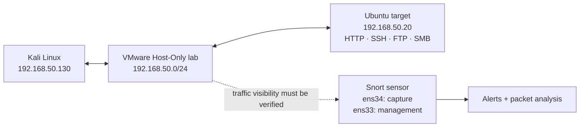
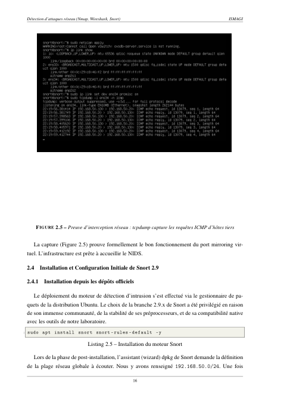

# Network Intrusion Detection Lab

A passive **Snort 2.9 NIDS** lab combining custom detection rules, controlled traffic from Kali Linux, and packet analysis with Wireshark.

I carried out most of the hands-on lab work for this ISMAGI *Projet de Fin d’Année* (2025–2026). The submitted report is coauthored with **Salaheddine Haidarah**. My work covered setting up the virtual environment, configuring the sensor, testing detection scenarios, and interpreting network traffic and alerts.

**Status:** The [French report](reports/rapport-nids-fr.pdf) documents the original multi-VM lab. The offline demo below can be reproduced independently. See [evidence and detection limits](docs/evidence-and-limitations.md) for the provenance of the original materials.

## Try the offline demo

[Replay two small PCAPs with Snort 2.9](demo/README.md). Both captures use the same UDP endpoints and payload length. One payload starts with a lab marker and triggers one alert. The benign payload produces no alerts. The walkthrough shows the rule, exact commands, and how to check the alert in Wireshark.

## What the lab does

- Observes an isolated `192.168.50.0/24` network using a separate capture interface.
- Detects selected traffic patterns with local Snort signatures and packaged rules.
- Compares alerts with packets captured using tcpdump/Wireshark.
- Explores detection limits, including the difference between a suspicious request and a successful compromise.

Snort runs in **passive IDS mode**. The lab does not demonstrate automatic blocking, an inline IPS, a SIEM integration, or measured detection accuracy.

## Architecture



Promiscuous mode lets an interface receive frames delivered to it; it does not configure switch mirroring. The report includes a capture of traffic between other hosts. A rebuilt VMware setup must verify that visibility independently. See [architecture and capture checks](docs/architecture.md).

## Detection examples

| Scenario | Local rule / evidence | Interpretation |
|---|---|---|
| Repeated SSH connections | SID `1000002`; report alert excerpt | Counts matching client banners; cannot inspect encrypted login attempts |
| HTTP traversal request | SID `1000003`; report also shows community SID `1122` | Matches literal payload strings, not proof that a file was read |
| SMB traffic | SID `1000005` | Broad established TCP/445 match; not specific proof of share enumeration |
| TCP XMAS scan | SID `1000006` | Matches FIN, PSH, and URG flags; no corresponding alert in the supplied excerpt |
| Anonymous FTP login | SID `1000007`; report alert excerpt | Detects a plaintext `USER anonymous` command |

The rules are retained as learning examples. See [evidence and detection limits](docs/evidence-and-limitations.md) before interpreting the sample log.

## Project materials

- [Original report — French PDF](reports/rapport-nids-fr.pdf)
- [Local Snort rules](rules/local.rules) and [network-variable excerpt](configs/snort.conf.network-vars)
- [Sensor network example](configs/netplan-stealth.yaml)
- [Sample report alerts](logs/snort.alert.sample.fast)
- [Setup and validation](docs/lab-guide.md)

<details>
<summary>Historical screenshot: traffic captured by the sensor</summary>



Source figure 2.5, PDF page 23.

</details>

## Using the reconstructed scripts

The lab uses Ubuntu Server 22.04, Snort **2.9**, VMware Workstation, and Kali Linux. Snort 3 uses a different configuration format. Create the isolated network and set the target address before using the scripts; installing services alone does not recreate the report's service configurations.

From the repository root on the appropriate lab VM:

```bash
# On the target: install the services used in the lab.
bash scripts/victim_setup.sh

# On the sensor: install rules and update the three lab network variables.
# This backs up snort.conf; it does not replace or apply Netplan.
bash scripts/sensor_setup.sh
```

Then follow the [lab guide](docs/lab-guide.md) to verify the capture path and start Snort.

## What I learned

This project helped me connect Linux networking, TCP/IP, rule syntax, and packet analysis. It also taught me to question what an alert actually proves: seeing a signature match is useful, but deciding whether an attack succeeded needs more evidence.
