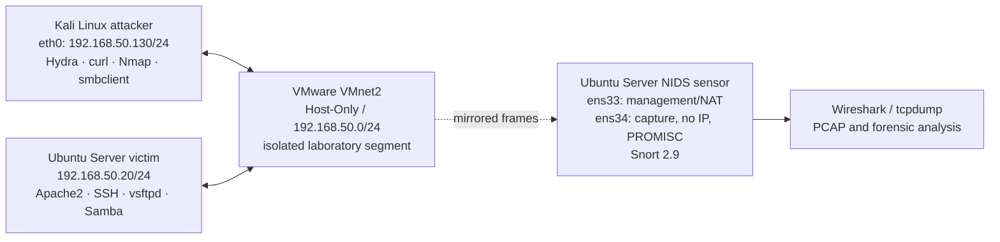

# Laboratory Architecture

## Design objective

The PFA implements a passive NIDS that observes traffic between a Kali attacker and an Ubuntu victim without routing, addressing, or modifying the monitored traffic. VMware Workstation is used to reproduce a SPAN-like monitoring path in an isolated Host-Only segment.

## Topology

## Traffic roles

| Component | Interface | Address | Role |
|---|---|---:|---|
| Kali Linux | `eth0` | `192.168.50.130/24` | Red Team traffic generator |
| Ubuntu victim | network interface | `192.168.50.20/24` | Controlled target |
| Snort sensor | `ens33` | DHCP management address | Administration and log access |
| Snort sensor | `ens34` | No IPv4/IPv6 address | Passive capture interface |

`ens34` is configured with DHCP and IPv6 router advertisements disabled. Promiscuous mode is then enabled so the VMware virtual switch can deliver copied frames from `VMnet2` to the sensor. The sensor is not an inline router and does not provide a gateway for the attacker or victim.

## Exposed victim services

| Service | Port | Purpose in the lab |
|---|---:|---|
| Apache2 | TCP/80 | Directory traversal simulation |
| OpenSSH | TCP/22 | Hydra brute-force simulation |
| vsftpd | TCP/21 | Anonymous-login policy detection |
| Samba | TCP/445 | SMB share enumeration |

## Detection flow

1. Kali generates a controlled test event against `192.168.50.20`.
2. VMware forwards the Host-Only traffic and its mirrored copy reaches `ens34`.
3. Snort decodes the traffic and evaluates community and local rules.
4. Alerts are written to `snort.alert.fast` and may be inspected in the console.
5. tcpdump/Wireshark can capture the same traffic for packet-level analysis.

An IDS alert identifies a suspicious network event or attempt. It does not, by itself, prove that the victim was compromised; host logs and service responses must be checked separately.
